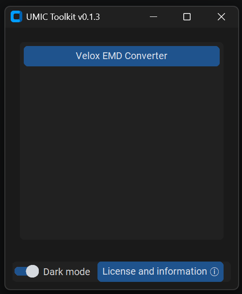
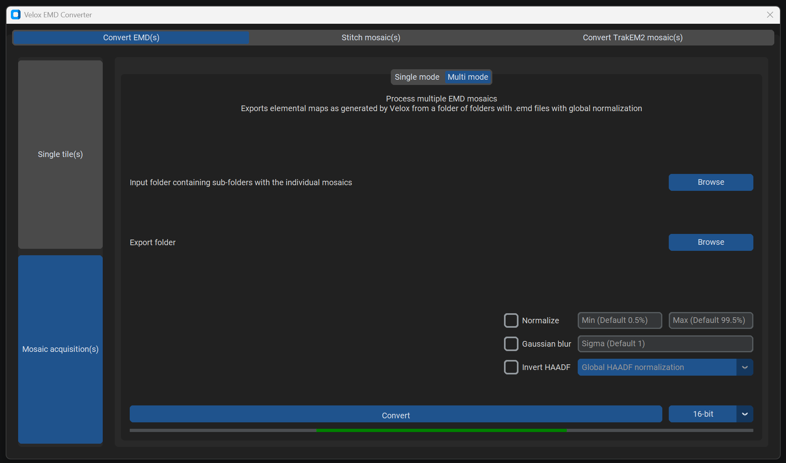

# UMIC_Toolkit
Common custom Python scripts used for UMIC-related workflows. These workflows have been translated to a GUI for accessibility. Note this is still work-in-progress.
<p align="center"></p>

## Modules
### EMD Converter
Extracts elemental maps as .tiff files from .emd files, provides instructions for stitching using TrakEM2 and enables converson to .ome.tiff-files.
<p align="center"></p>

### biomero-converter
Converts microscopy files to OME-Zarr (v0.4/v0.5/v0.6) or OME-TIFF using <a href=https://github.com/NL-BioImaging/biomero-converter>biomero-converter</a>. Supports Leica (.lif, .lof, .xlef, ...), Incucyte archives (.icarch), iSyntax, MIRAX (.mrxs), DICOM, image .db files, (OME-)TIFF and OME-Zarr. Several files can be queued and converted in one go.

It is installed with the other requirements (see below). If it is not installed, the EMD Converter still works and the toolkit shows an install hint when the biomero-converter module is opened.

## Usage
The GUI can be launched from the command line or packaged into an .exe. First the appropriate environment will have to be created and the repository has to be cloned.

### Create environment
The toolkit requires **Python 3.12 or newer**. Create a <a href =https://docs.conda.io/en/latest/> conda</a> environment with a suitable Python version.

```bash
conda create --name environment_name python=3.12
```

Activate the conda environment.
```bash
conda activate environment_name
```

### Clone the repository
Create a directory where you want a clone of the repository and navigate to it.
For example:

```bash
cd "D:/Github/UMIC_Toolkit"
```

Clone the repository.

```bash
git clone https://github.com/BHPD/UMIC_Toolkit.git
cd UMIC_Toolkit
```

### Install packages
Install the toolkit and its dependencies (defined in pyproject.toml), including the optional biomero-converter module:

```bash
pip install -e ".[biomero_converter]"
```
Leave out `[biomero_converter]` to install only the EMD Converter. `pip install -r requirements.txt` does the same as the command above. Only minimum versions are specified (in pyproject.toml), so the latest compatible versions of all packages are installed.

To build the .exe, also install the build requirements: `pip install -r requirements-build.txt` (or `pip install -e ".[build]"`).

### Launch GUI
Activate the appropriate environment.
Navigate to the directory where the repository is cloned.
```bash
python main.py
```
or, after `pip install -e .`, simply `umic-toolkit`.

### (Optional) package the GUI into a .exe for convenience
Using PyInstaller (no paths need to be changed; installed packages are located automatically):
```bash
pyinstaller build.spec --clean
```

For debugging a build locally (Windows PowerShell), `_testing/build_exe_debug.ps1` builds the .exe in a throwaway environment in %TEMP% (nothing is written to the repository), checks that the files the app loads at runtime are included, and can run the exe in the console so errors stay visible:
```powershell
.\_testing\build_exe_debug.ps1 -Run
```
Add `-Package` to also create the zip a release would publish (the build folder and exe are kept). See the top of the script for all options (`-RunOnly`, `-Upgrade`, `-Reinstall`, `-Cleanup`, ...).

## License
The UMIC Toolkit is licensed under the <a href=https://www.gnu.org/licenses/gpl-3.0.html>GNU General Public License v3.0 or later</a> (GPL-3.0-or-later); see [LICENSE](LICENSE). Licenses of third-party packages are listed in [assets/licenses.txt](assets/licenses.txt).
